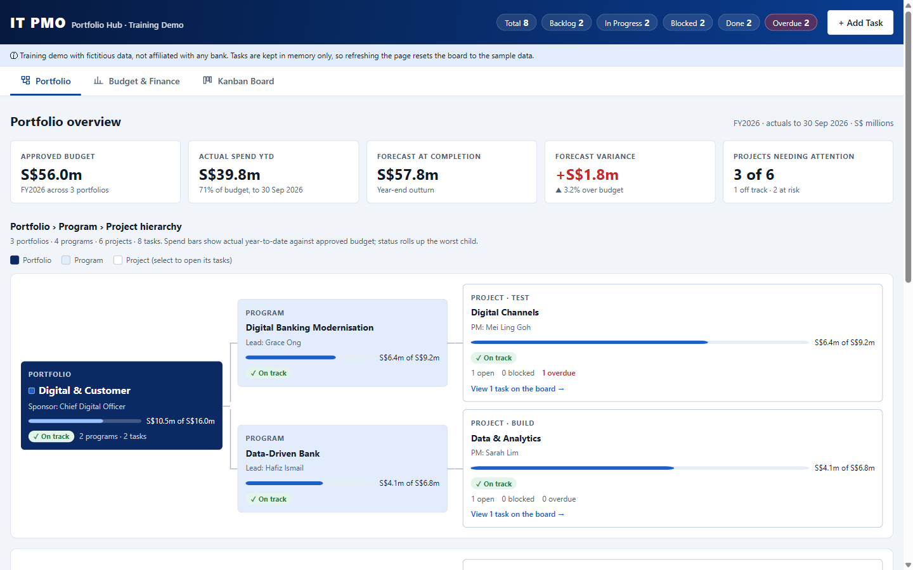
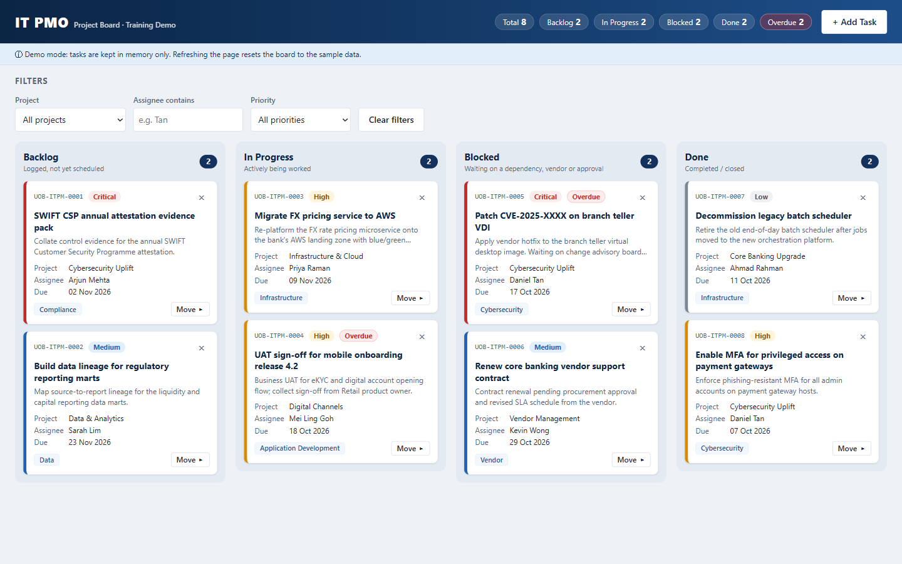

# IT PMO Kanban Board (Demo)

An IT PMO Kanban board demo for a fictitious bank, built as single files of vanilla HTML, CSS and JavaScript. v2 adds a portfolio hierarchy, budget and spend charts, and security hardening.

[](index.html)
[](index.html)
[](index.html)


[](https://github.com/aungmyatko/claude-code-training/actions/workflows/deploy-pages.yml)
[](https://github.com/aungmyatko/claude-code-training/actions/workflows/ci.yml)
[](https://aungmyatko.github.io/claude-code-training/)
[](https://aungmyatko.github.io/claude-code-training/v2/)


## Live demo

| Version | URL | What it is |
| --- | --- | --- |
| **v2: Portfolio Hub** | **<https://aungmyatko.github.io/claude-code-training/v2/>** | Portfolio › program › project hierarchy, budget and spend charts, hardened Kanban board, blue theme with dark mode |
| v1: Kanban board | <https://aungmyatko.github.io/claude-code-training/> | The original single-page board (unchanged) |

### v2: Portfolio Hub



### v1: Kanban board



## What's new in v2

- **Portfolio overview:** KPI tiles (approved budget, actual spend, forecast at completion, variance, projects needing attention) and a connected **portfolio › program › project hierarchy**. Each node shows a spend bar, a rolled-up status (the worst child wins, shown with an icon and a label) and live task counts. Selecting a project opens its tasks on the board.
- **Budget and finance charts** (inline SVG, no libraries):
  - Cumulative spend against plan, with the forecast to year end, a crosshair tooltip and arrow-key reading.
  - Budget, actual and forecast by project (bullet chart) with over/under-budget flags.
  - A budget allocation treemap by portfolio and project.
  - The CAPEX/OPEX split by portfolio.
  - A data-table view of all finance figures.
- **Blue corporate theme** with a full dark mode that follows the OS setting. Chart colours were checked with a colour-vision-deficiency palette validator.
- **Security hardening** (see below).
- Board additions: a portfolio filter and a program line on each card.

## Security (v2)

v2 was threat-modelled with STRIDE as a static, client-only page. Controls:

| Threat | Control in `v2/index.html` |
| --- | --- |
| Cross-site scripting (tampering, elevation of privilege) | Strict `Content-Security-Policy`: `default-src 'none'`, and inline script and style are allowed **only by SHA-256 hash** (no `unsafe-inline`, no `unsafe-eval`). Every user value goes through `escapeHtml()`. Tooltips and toasts use `textContent`. There are no inline event handlers. |
| Data exfiltration / information disclosure | `connect-src` is limited to `https://formsubmit.co`, `img-src` to `data:`, and `form-action`, `base-uri` and `object-src` are `'none'`. A `no-referrer` policy is set and requests use `credentials: "omit"`. No request is sent at all while the FormSubmit address is the placeholder. |
| Spoofed task text, email header injection | The input sanitiser strips control, zero-width and bidi-override characters (such as `U+202E`) and collapses whitespace. The email subject is forced onto one line. Assignee names allow only letters, spaces, `.`, `'` and `-`. Dates must be real calendar dates within five years. |
| Abuse / denial of service | Notifications are rate limited (one per 5 s, 25 per page load). Double submits are blocked, the board is capped at 200 tasks, and a honeypot field drops bot submissions. |
| Runtime tampering | Reference data is deep-frozen. Drag and drop only accepts drags that started on the board. Filter values are checked against the reference lists. |

Residual risk: GitHub Pages can't send HTTP response headers, so `frame-ancestors` (clickjacking protection) and HSTS can't be set from the page. The page holds no secrets or sessions, so the impact is low.

After editing the inline `<script>` or `<style>` in `v2/index.html`, refresh the CSP hashes, or the page won't run:

```bash
python tools/csp_hash.py v2/index.html
```

CI fails if the hashes are stale.

## Features

- **Four status columns:** Backlog, In Progress, Blocked and Done, with per-column counts and a live summary in the header.
- **Add Task form with validation:** title, project, category, priority, assignee and due date. Errors show inline next to each field. Each new task gets an ID in the format `UOB-ITPM-####`.
- **Move tasks** with a per-card "Move to…" menu (keyboard friendly) or by native drag and drop between columns.
- **Inline delete confirmation:** "Delete? Yes / No" on the card. There are no browser pop-ups.
- **Filters** by project, assignee (contains) and priority, plus a "Clear filters" button.
- **Overdue highlighting:** cards past their due date that aren't Done are flagged.
- **Optional email notification** for new tasks through [FormSubmit](https://formsubmit.co/). A failed notification only shows a warning toast and never breaks the board.

## Installation

```bash
git clone https://github.com/aungmyatko/claude-code-training.git
cd claude-code-training
```

There's nothing to install. You don't need Node, npm or any packages.

## How to run

**Quick:** open `index.html` (v1) or `v2/index.html` (v2) in a browser. Both work straight from disk (`file://`).

**Local server** (needed for FormSubmit email, because FormSubmit rejects `file://` origins):

```bash
python -m http.server 8000
```

Then open <http://localhost:8000> for v1 or <http://localhost:8000/v2/> for v2.

## Configuration

Email notifications are off until you set the destination address. The only place it's set is the `FORMSUBMIT_ENDPOINT` constant at the top of the `<script>` block in `index.html` (v1) or `v2/index.html` (v2). After changing v2, run `python tools/csp_hash.py v2/index.html` to refresh its CSP hashes.

```js
const FORMSUBMIT_ENDPOINT = "https://formsubmit.co/ajax/YOUR_EMAIL@example.com";
```

1. Replace `YOUR_EMAIL@example.com` with your address.
2. Serve the page over http (see above) and add a task.
3. FormSubmit sends a **one-time activation email** to that address. Click the link in it, and later submissions are delivered. Email subjects start with `[UOB IT PMO]`.

> **Do not commit a real email address to a public repository.** It would be published on the GitHub Pages site. Keep the placeholder here, and set a real address only in a local copy or a private fork.

## Notes

- **No persistence, by design.** Tasks live in memory only. Refreshing the page resets the board to the seed data, and the page shows a note saying so.
- Seed due dates are relative to today, so some cards are always overdue.
- All names, projects and tasks are **fictitious demo data**. This project isn't affiliated with, endorsed by or connected to any real bank. It uses a neutral "IT PMO" wordmark and no real logos or systems.

## Deployment / CI-CD

Two GitHub Actions workflows live in `.github/workflows/`:

- **`ci.yml`** runs on every push and pull request with read-only permissions. It has three jobs:
  - HTML validation of both pages (`html-validate@8`, configured in `.htmlvalidate.json`).
  - A full-history secret scan with Gitleaks.
  - A constraints check that fails if either page uses `localStorage`, `sessionStorage`, `indexedDB`, `document.cookie`, `alert(`, `confirm(`, `eval(`, `new Function`, `!important`, `<script src=` or `type="module"`. It also fails if the v2 CSP hashes are stale, or if the CSP allows `unsafe-inline`, `unsafe-eval` or wildcards.
- **`deploy-pages.yml`** runs on every push to `main` and on manual dispatch. It runs CI first, so a failing check blocks the deploy. It then copies **only the two pages** into the Pages artifact (`index.html` at `/` and `v2/index.html` at `/v2/`) and deploys them to GitHub Pages.

## Project structure

```text
.
├── index.html                  # v1: the whole app (markup, <style> and <script>)
├── v2/
│   └── index.html              # v2 Portfolio Hub (single file, hash-based CSP)
├── tools/
│   └── csp_hash.py             # Recomputes / checks the v2 CSP hashes
├── README.md
├── CLAUDE.md                   # Guidance for Claude Code
├── .gitignore
├── .htmlvalidate.json          # html-validate config used by CI
├── docs/
│   ├── screenshot.png          # v1 README screenshot (not deployed to Pages)
│   └── screenshot-v2.png       # v2 README screenshot (not deployed to Pages)
└── .github/
    └── workflows/
        ├── ci.yml              # Validation, secret scan, CSP and constraints checks
        └── deploy-pages.yml    # CI + deploy both pages to GitHub Pages
```
